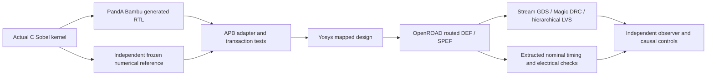

# Sobel C-to-RTL and SKY130 demonstration

PandA Bambu generates the actual Verilog arithmetic for a saturated eight-bit Sobel window kernel. An APB wrapper supplies pixels and captures the result. Independent C/Python reference checks, RTL and gate simulations, routed timing, Magic DRC and hierarchical Netgen LVS test the implementation at the scope below. **Crucible is beta.**

- [Quick start](#quick-start)
- [How it works](#how-it-works)
- [What runs](#what-runs)
- [Repository layout](#repository-layout)
- [Individual stages](#individual-stages)
- [Results and controls](#results-and-controls)
- [Troubleshooting](#troubleshooting)
- [Reports and limits](#reports-and-limits)
- [Licence](#licence)

The reviewed [twelve-page PDF](docs/Sobel_HLS_APB_SKY130_Ignytion_A4.pdf) and [editable A4 PowerPoint](docs/Sobel_HLS_APB_SKY130_Ignytion_A4.pptx) are included. [Compact results](evidence/summary.json), [dependency identities](evidence/dependencies.json) and [document hashes](evidence/documents.sha256.json) preserve the recorded measurements. Raw logs and generated builds stay outside Git.

## Recorded result

Measured locally through 29 October 2026:

| Check | Outcome |
|---|---|
| C and generated core | 5,162 frozen windows; 126 distinct outputs, 4,382 unsaturated |
| APB, mapped and routed netlists | 67,124 checks per APB run; zero-delay functional models |
| Extracted nominal setup / hold | +11.72 / +0.12 ns worst slack at a 20 ns clock |
| Slew / capacitance / fanout | Zero reported violations |
| Magic DRC | Zero reported errors |
| Hierarchical LVS | Unique match; 874 devices and 921 nets on each side |
| Negative controls | Wrong expected result, disconnected result-Q reference and infeasible 1 ns clock rejected |

Numerical agreement is sampled evidence rather than exhaustive equivalence proof. Timing uses SKY130 HD TT 25 C/1.80 V and nominal OpenRCX extraction. The hierarchical comparison retains supply/body pins and exempts physical filler/tap classes through the PDK setup.

## Numerical and register contract

Supply nine unsigned byte pixels p0 through p8 in row-major order. Compute `gx = -p0+p2-2*p3+2*p5-p6+p8` and `gy = -p0-2*p1-p2+p6+2*p7+p8`. The output is `min(255, abs(gx)+abs(gy))`, with signed integer intermediates. This is the L1 gradient approximation. The caller supplies the complete window; frame storage and image-border handling are outside this kernel.

| Offset | Register |
|---|---|
| 0x00 | Write bit 0 to start; reads return zero |
| 0x04 | Read status: bit 0 busy, bit 1 sticky done |
| 0x08 | Read result in bits 7:0 |
| 0x10 | Read/write p0 through p3, with p0 in the least significant byte |
| 0x14 | Read/write p4 through p7, with p4 in the least significant byte |
| 0x18 | Read/write storage; p8 uses bits 7:0 |

Reset is active low. APB accesses have no wait states; setup phases have no write side effects. Invalid/unaligned addresses and writes to status/result return errors. The generated arithmetic is combinational and done follows start. The wrapper captures the result on the following core-completion edge, before the next legal APB access; this is not a multi-cycle backpressure demonstration.

## Quick start

Open a Linux/WSL terminal in this repository root. Crucible is beta. A complete SKY130A PDK, host GCC, native runtime libraries and the locked Bambu/RTL/physical tools are required. The Bambu archive is approximately 1.39 GB on initial acquisition. Required PDK views include HD LEF/Liberty/GDS/functional Verilog, Magic technology, Netgen setup and OpenRCX rules. The managed setup target installs pinned KLayout Python bindings into ignored build/observer.

```sh
igny init
igny workspace sync
igny tool install make --version 4.4.1 --env hls-sobel
igny run --env hls-sobel make setup
igny run --env hls-sobel make check
```

The default PDK is $HOME/.ciel/sky130A. Pass PDKPATH to Make for another complete installation; CAD_ROOT may override the managed Magic library root. [Dependency identities](evidence/dependencies.json) and [example configuration](config/example.env.sh) identify the measured inputs. The lock does not supply the PDK or host GCC.

Run the complete experiment after satisfying those prerequisites:

```sh
igny run --env hls-sobel make run PDKPATH=/path/to/sky130A
```

Every executable example in this guide goes through Igny. Make delegates to the supplied stage scripts and observers; failed stages stop the workflow. Make 4.4.1 is installed separately from the existing engineering-tool lock. The setup target uses the Igny-launched Python interpreter to install requirements.txt into an ignored project-local prefix at build/observer, then checks the imported module locations. It does not change system Python or a shared tool payload. The check target checks observer imports; it does not qualify a PDK or native-library installation.

## How it works

Bambu generates the arithmetic from the actual C function. An APB wrapper supplies a complete nine-byte window and captures the saturated eight-bit result. The C/reference vectors, generated core, APB transactions and mapped/routed netlists are checked separately. Physical verification reads actual streamed geometry and retains supply/body connectivity.



## What runs

| Component | Pinned version |
|---|---|
| bambu | 2024.10 |
| iverilog | 14.0.0 |
| klayout-stream | 0.30.10 |
| magic | 8.3.682 |
| netgen | 1.5.323 |
| openroad | 26Q3-771-g7cfb2105c9 |
| yosys | 0.63.0 |

The lock restores those engineering tools; the setup target prepares only project-local observer dependencies where needed. Initial acquisition may require network access. Native Windows/macOS/ARM tool execution and independent clean-machine reproduction are not established by these results.

## Repository layout

```text
.
|-- Makefile             Managed workflow entry points
|-- crucible.toml        Workspace selection
|-- crucible.lock        Engineering-tool identities
|-- src/                 Actual C kernel
|-- reference/           Frozen vectors and deliberately corrupted expectation
|-- rtl/                 Core adapter and APB wrapper
|-- tests/               Independent numerical and bus benches
|-- scripts/             HLS, physical flow, verification and provenance
|-- docs/                Reviewed PDF and editable PowerPoint
|-- evidence/            Compact reviewed measurement snapshots
`-- build/               Generated local artifacts; ignored by Git
```

## Individual stages

Run these from the same prepared workspace. Stages use earlier outputs; execute them in the listed order when reproducing the flow manually. The run target performs the full ordered workflow.

| Managed command | Work performed |
|---|---|
| `igny run --env hls-sobel make reference` | Compile C and generate/check the frozen independent vector set |
| `igny run --env hls-sobel make hls` | Generate actual arithmetic RTL with Bambu |
| `igny run --env hls-sobel make core` | Compare generated arithmetic with the vectors and corrupted-expectation control |
| `igny run --env hls-sobel make apb` | Exercise register/start/result behaviour and its negative control |
| `igny run --env hls-sobel make synth` | Map generated RTL with the real Liberty library |
| `igny run --env hls-sobel make mapped` | Repeat APB checks with unchanged official cell models |
| `igny run --env hls-sobel make physical` | Floorplan, place/repair, CTS, route and extract RC |
| `igny run --env hls-sobel make stream` | Add physical supply ports and stream cell geometry |
| `igny run --env hls-sobel make routed` | Repeat the functional suite against the final routed netlist |
| `igny run --env hls-sobel make physical-verify` | Check/extract GDS in Magic and compare hierarchical netlists |
| `igny run --env hls-sobel make controls` | Reject disconnected result-Q LVS and deliberately infeasible timing |
| `igny run --env hls-sobel make provenance` | Record hashes of actual PDK views |

Inspect or recheck existing results without rebuilding:

```sh
igny run --env hls-sobel make smoke
igny run --env hls-sobel make report
igny run --env hls-sobel make help
```

The smoke target validates existing generated evidence. It is not a new experiment run. The report target prints local summaries and fails if required results are absent. The sed target normalises only public shell inputs to LF; run invokes it automatically.

## Results and controls

Require SOBEL_NUMERICAL_APB_PHYSICAL_AND_NEGATIVE_CONTROLS_VERIFIED. Recorded coverage is 5,162 windows and 67,124 comparisons per APB/mapped/routed run. Extracted nominal setup/hold slack is +11.72/+0.12 ns at 20 ns; DRC/electrical violation counts are zero and hierarchical LVS matches 874 devices/921 nets. Wrong expected bytes, disconnected result-Q and the infeasible 1 ns clock must fail for their intended causes.

Expected negative failures are handled by the existing runners/observers. Missing tools, compilation failures, timeouts and missing artifacts do not count as successful controls. Changing sources or inputs requires rerunning the affected stages and their dependents. Raw logs and generated runtime/PDK payloads remain local.

## Troubleshooting

| Symptom | Check / next action |
|---|---|
| Wrong workspace or missing tool | Open the terminal in the root containing crucible.toml; use the explicit project environment in this guide and restore the lock. |
| Make is not bound | Repeat the managed Make installation in Quick start. |
| Observer dependency is absent or changed | Repeat the managed setup target; retain the pinned requirements. |
| Native library or PDK is missing | Supply the prerequisites described above. Lock restoration and observer setup do not provision them. |
| Evidence is missing or stale | Run the full workflow or the affected stages in order. Preserve the reported failure instead of editing expected values. |
| Negative control unexpectedly passes | Treat the guard as failed and inspect its artifacts. |

## Reports and limits

Read the [technical report](docs/Sobel_HLS_APB_SKY130_Ignytion_A4.pdf) or its [editable PowerPoint](docs/Sobel_HLS_APB_SKY130_Ignytion_A4.pptx). The documents record measured results and exclusions; source commands in this README are the current managed workflow.

One window-level L1-gradient kernel and a bounded APB contract. No frame buffering, border handling or exhaustive equivalence claim. Timing uses nominal TT 25 C/1.8 V extraction; this does not establish multi-corner signoff, fabrication or silicon performance.

Review the source/document package locally with:

```sh
igny run --env hls-sobel make preflight
```

This checks the public candidate and document hashes; it does not publish anything or rerun engineering verification.

## Licence

Dependencies retain their upstream licences and credit. This checkout has no project-wide licence grant; the owner must select the intended project licence before presenting it as an open-source release. No upstream endorsement is implied.

Source repository: [CRUCIBLE-WORKBENCH/HLS_Sobel](https://github.com/CRUCIBLE-WORKBENCH/HLS_Sobel).
